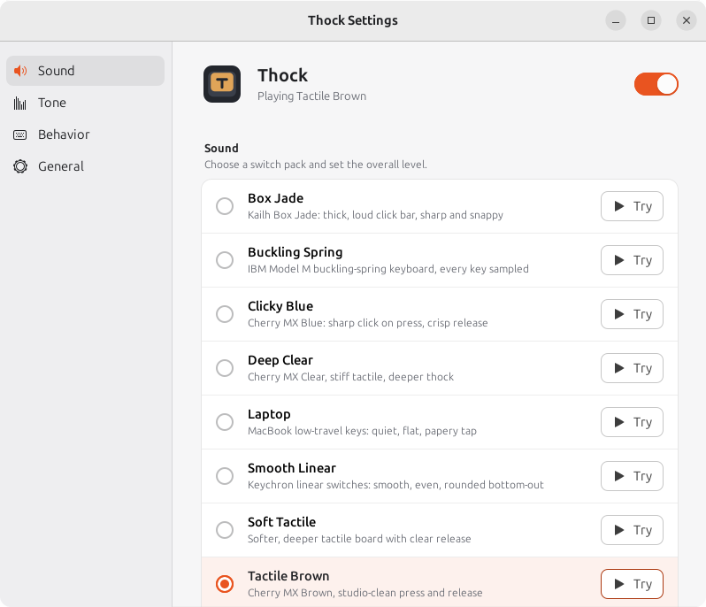

<p align="center"></p>

<h1 align="center">Thock</h1>

<p align="center"><strong>Mechanical keyboard sounds for your Linux desktop.</strong><br>
Every key you press plays a real switch recording. It lives in your tray and stays out of the way.</p>

<p align="center">
  <a href="https://github.com/christophervistal25/thock/releases/latest/download/thock-linux.tar.gz"><strong>Download for Linux</strong></a> ·
  <a href="https://christophervistal25.github.io/thock/">Website</a> ·
  <a href="#troubleshooting">Troubleshooting</a>
</p>

<p align="center"></p>

## Features

- **11 sound packs** from real recordings: Buckling Spring (IBM Model M), Clicky Blue, Tactile Brown, Soft Tactile, Deep Clear, Smooth Linear, Box Jade, Topre, Vintage Alps, Typewriter and Laptop.
- **Press and release sounds**, with their own samples for Space, Enter and Backspace where the recording has them.
- **Tone control** from deep "thock" to bright "clack".
- **Spatial audio**: left-hand keys play on the left speaker, right-hand keys on the right.
- **Mouse clicks** for the left, right and middle buttons (optional).
- **Sound on key repeat** (optional): a click on every auto-repeat while a key is held.
- **Natural variation**: tiny pitch and volume changes so repeated keys don't sound robotic.
- **Tray menu and settings window** that follow your light or dark theme. Starts at login if you want it to.
- **About 15 ms** from key press to sound.
- **Private**: Thock only uses which key went down or up to pick and pan a sound, then forgets it. Nothing you type is logged, stored or sent, and it makes no network connections.

## Requirements

- Ubuntu 22.04 or newer, or another Debian-based Linux.
- An **X11** session. Check with `echo $XDG_SESSION_TYPE` (it should print `x11`). On Ubuntu, pick **Ubuntu on Xorg** from the gear icon on the login screen.

## Install

**Option 1: download the release (no git needed)**

```sh
cd ~
wget -qO- https://github.com/christophervistal25/thock/releases/latest/download/thock-linux.tar.gz | tar xz
cd thock && ./install.sh
bin/thock
```

**Option 2: clone the repository**

```sh
sudo apt install git
git clone https://github.com/christophervistal25/thock ~/thock
cd ~/thock && ./install.sh
bin/thock
```

`install.sh` installs any missing system packages (asks for your password once), creates a Python
environment inside the folder, adds **Thock** to the app menu and turns on start at login. It's safe to re-run.
Keep the folder where you installed it: the app menu entry and autostart point to it.

To update a git install: `cd ~/thock && git pull && ./install.sh`. To update a download, extract the new
release over the old folder and run `./install.sh` again (your settings are kept).

## Using Thock

| What | How |
|---|---|
| Open settings | App menu → **Thock**, tray icon → **Settings…**, or `bin/thock --settings` |
| Start | `bin/thock` (also starts at login) |
| Quit | Tray → **Quit Thock**, or `bin/thock --quit` |
| Pause sounds | Tray → **Sounds On** (uncheck), or the switch at the top of the settings window |
| Test the sound | `bin/thock --self-test` (current pack) or `bin/thock --self-test --all-packs` |
| Measure latency | `bin/thock --latency-test` |
| Settings file | `~/.config/thock/config.json` (preferences only) |

All commands are run from the Thock folder (for example `cd ~/thock`).

## Troubleshooting

**Thock doesn't open from the app menu**
Run it in a terminal so you can see the error:
```sh
cd ~/thock && bin/thock --settings
```
If it was started at login, earlier errors are in the journal: `journalctl --user -b | grep -i thock`.
The fixes below cover the usual messages.

**`No module named thock`**
The app menu entry points to a folder that moved or is out of date. Update and re-run the installer from
the folder you want to keep:
```sh
cd ~/thock && git pull && ./install.sh     # or extract the latest release here, then ./install.sh
```

**`No module named 'gi'`, `Namespace Gtk not available`, `Namespace AyatanaAppIndicator3 not available`,
`No module named 'Xlib'`, `PortAudio library not found` or `No module named 'sounddevice'`**
A system package or the Python environment is missing. Re-run the installer, which installs what's missing:
```sh
cd ~/thock && ./install.sh
```
Or install the system packages by hand, then run `./install.sh` again:
```sh
sudo apt install python3-venv python3-gi python3-xlib gir1.2-gtk-3.0 gir1.2-ayatanaappindicator3-0.1 libportaudio2
```
If the error persists, delete the environment so it's rebuilt: `rm -rf .venv && ./install.sh`.

**No sound at all while typing, and you're on Wayland**
`echo $XDG_SESSION_TYPE` prints `wayland`. Wayland doesn't let apps hear system-wide key presses, so Thock
can't work there. Log out, click the gear icon on the login screen, choose **Ubuntu on Xorg**, and log in again.

**No tray icon (GNOME)**
GNOME needs the AppIndicator extension to show tray icons. Ubuntu ships it on by default
(*Ubuntu AppIndicators*). Check and turn it on:
```sh
gnome-extensions list --enabled | grep -i appindicator
gnome-extensions enable ubuntu-appindicators@ubuntu.com
```
On other distributions install **AppIndicator and KStatusNotifierItem Support** from extensions.gnome.org.
Thock still works without the icon; use `bin/thock --settings` to change settings.

**No sound, or sound comes out of the wrong device**
1. Check that the right output is selected and not muted in **Settings → Sound**.
2. Check Thock isn't paused (tray → **Sounds On**, or the switch in settings) and the volume isn't at 0.
3. Run `bin/thock --self-test`. If you hear the test sweep, audio works and the problem is key capture
   (see Wayland and RECORD below). If you don't, it's the audio output.
4. Thock uses your system default output, so switch the default device in Sound settings, then restart
   Thock (`bin/thock --quit`, then `bin/thock`).

**Sound feels delayed**
Run `bin/thock --latency-test`; a healthy result is around 15 ms in total. Thock asks PipeWire for a
256-frame buffer. You can ask for a smaller one, or a larger one if you hear crackles:
```sh
bin/thock --quit
PIPEWIRE_LATENCY=128/48000 bin/thock     # lower latency
PIPEWIRE_LATENCY=512/48000 bin/thock     # more stable on slow machines
```
Bluetooth headphones add their own delay (often 100 ms or more); wired or USB audio is much faster.

**`X server has no RECORD extension`**
Thock reads key presses through the X11 RECORD extension, which almost every X server has. Check with:
```sh
xdpyinfo | grep -i record
```
If nothing is printed, your X server has it disabled (look for `Option "RECORD" "false"` or a `Disable` line
in `/etc/X11/xorg.conf` or `/etc/X11/xorg.conf.d/`). Inside remote desktops and some virtual machines it may
not be available at all.

**"Already running", or the settings window won't open**
Only one copy of Thock runs at a time; opening it from the app menu again (or `bin/thock --settings`) just
brings up the settings window of the running copy. If the window doesn't appear, stop it and start fresh:
```sh
bin/thock --quit
pkill -f "python -m thock"     # only if --quit didn't stop it
bin/thock --settings
```

**Turn off start at login**
Settings → General → **Start at login** off, or:
```sh
rm ~/.config/autostart/thock.desktop
```

**Uninstall**
```sh
cd ~/thock && bin/thock --quit
rm -f ~/.config/autostart/thock.desktop ~/.local/share/applications/thock.desktop
rm -rf ~/.config/thock      # your settings
cd ~ && rm -rf ~/thock      # the app itself
```
The system packages `install.sh` added are shared with other apps, so they are left in place.

Still stuck? [Open an issue](https://github.com/christophervistal25/thock/issues) with the output of
`bin/thock --settings` and `echo $XDG_SESSION_TYPE`.

## Privacy

Input is read with the X RECORD extension. Only the event type (key down, key up, mouse button) and the
keycode are used, in memory, to choose and pan a sound, and are dropped immediately. Nothing you type is
logged, stored or sent. Thock makes no network connections.

## Sound credits

All packs are genuine recordings shared under free licenses; most are CC0 (public domain). Sources,
authors, licenses and the required CC BY 4.0 attributions are in [SOUNDS-LICENSES.md](SOUNDS-LICENSES.md).
The Buckling Spring pack comes from [bucklespring](https://github.com/zevv/bucklespring) by Ico Doornekamp (GPL-2.0).

## Development

- Run the tests: `.venv/bin/python -m unittest discover -s tests -v`
- Rebuild the sound packs from their sources: `tools/build_packs.py` (needs the source downloads listed in SOUNDS-LICENSES.md)
- The landing page lives in `docs/` and is served by GitHub Pages. Its in-browser typing test (`docs/typing.js`) plays 32 kHz copies of the packs from `docs/assets/packs/`; rebuild them after changing a pack with `.venv/bin/python tools/build_web_packs.py`.
